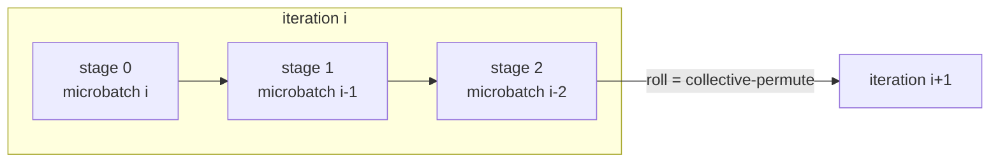

# Jaxotron 🚀

[](https://github.com/rishiraj/jaxotron/actions/workflows/ci.yml)
[](https://pypi.org/project/jaxotron/)


[](https://colab.research.google.com/github/rishiraj/jaxotron/blob/main/notebooks/jaxotron_tour.ipynb)
[](https://kaggle.com/kernels/welcome?src=https://github.com/rishiraj/jaxotron/blob/main/notebooks/jaxotron_tour.ipynb)

**Minimal, hackable 4D-parallel LLM pre-training in pure JAX.**
Data, Tensor, Pipeline and Context parallelism (plus FSDP/ZeRO-3) for Llama-style models in about 1,000 lines of readable code. It runs on a laptop, a GPU node or a TPU pod, and loads real Hugging Face Llama / SmolLM2 weights.

Inspired by Hugging Face's [Picotron](https://github.com/huggingface/picotron) / [Nanotron](https://github.com/huggingface/nanotron) and Google DeepMind's [How to Scale Your Model](https://jax-ml.github.io/scaling-book/).

```bash
pip install jaxotron
jaxotron-train --cpu_devices 16 --dp 2 --pp 2 --cp 2 --tp 2 --show_collectives   # 4D parallelism on your laptop
```

---

## Why Jaxotron?

| | PyTorch (Picotron-style) | Jaxotron |
|---|---|---|
| Tensor parallel | Custom `ColumnParallelLinear` / `RowParallelLinear` + autograd functions | One line per tensor: name its axes |
| Pipeline parallel | Hand-written send/recv, AFAB / 1F1B schedules, separate backward | ~40 lines; `jax.grad` derives the backward pipeline |
| Context parallel | Custom ring attention with manual backward | One sharding annotation on K/V |
| FSDP / ZeRO-3 | Wrapper module, bucketing, hooks | A rule: `"embed" → "fsdp"` |
| Communication | Explicit `all_reduce` / `isend` calls | Inserted by the XLA compiler, and `--show_collectives` shows you exactly which |
| Checkpoints | One file per (tp, pp) rank, same topology to resume | Topology-independent: train on 16 devices, resume on 2, sample on 1 |
| Runs on | GPUs | GPUs, TPUs, and CPU (simulated devices) |

Every parallel layout is **tested to produce the same loss and gradients as a single device**, and pretrained checkpoints are **tested to produce the same logits as 🤗 Transformers**.

---

## ✨ Features

- **5 parallelism axes, freely combinable**: `dp × fsdp × pp × cp × tp`.
- **See the communication**: `--show_collectives` lists every all-reduce, all-gather and collective-permute XLA inserted, attributed to the mesh axis it runs over.
- **Pretrained weights**: `--init_from_hf HuggingFaceTB/SmolLM2-135M` (or any Llama 2 / 3.x / SmolLM checkpoint) loads safetensors straight into the sharded layout. No PyTorch needed.
- **Llama architecture**: RoPE (including Llama 3.1 scaling), RMSNorm, SwiGLU, Grouped-Query Attention. Presets: `tiny`, `125m`, `smollm2-135m/360m/1.7b`, `llama3.2-1b/3b`, `llama3.1-8b`.
- **Runs anywhere**: `--cpu_devices N` simulates N accelerators on a laptop, which makes it ideal for talks, classrooms and CI. Free Kaggle TPU v5e-8 and Colab work out of the box.
- **Sharded from birth**: parameters and optimizer state are created directly in their sharded layout, so no device ever holds the full model.
- **Topology-independent checkpoints** (Orbax, async, multi-host): train with 4D parallelism, resume or sample on any other layout. Ctrl+C saves a checkpoint, and re-running the same command resumes.
- **Deterministic, resumable data**: memory-mapped token files; batch order is a pure function of the step; each host reads only its own rows.
- **Production basics**: bf16 mixed precision, activation rematerialisation, gradient accumulation, AdamW with warmup and cosine decay, gradient clipping, eval loop, MFU reporting, profiler traces, NaN guard, persistent compilation cache, optional Weights & Biases.
- **Inspectable**: `--show_sharding` prints how every weight is split; `--show_mesh` prints which device owns which coordinates; `--dry_run` prints per-device memory.
- **Minimal dependencies**: `jax`, `equinox`, `optax`, `orbax-checkpoint`, `numpy`.

---

## 🚀 Quick start

```bash
pip install jaxotron                 # CPU (laptops, Colab, CI)
pip install "jaxotron[cuda]"         # NVIDIA GPUs (CUDA 12; use [cuda13] for CUDA 13)
pip install "jaxotron[tpu]"          # Cloud TPU / Kaggle TPU
pip install "jaxotron[hf,data]"      # + Hugging Face weights, tokenizers and datasets
```

From source: `git clone https://github.com/rishiraj/jaxotron && cd jaxotron && pip install -e ".[dev]"`. Every `jaxotron-*` command is also available as `python train.py`, `python generate.py` and `python prepare_data.py` in a checkout.

**1. Train with 4D parallelism on a laptop (16 simulated devices).** A learnable synthetic dataset is generated automatically:

```bash
jaxotron-train --cpu_devices 16 --dp 2 --pp 2 --cp 2 --tp 2 \
    --seq_len 128 --global_batch_size 16 --micro_batch_size 4 --steps 60
```

```
Mesh: {'dp': 2, 'pp': 2, 'fsdp': 1, 'cp': 2, 'tp': 2}  ->  DP=2 x PP=2 x CP=2 x TP=2
Pipeline bubble: 20% of pipeline time is idle (raise micro_batch_size / --pp_microbatches to shrink it)
Compiled the train step in 19.3s
step      1 | loss 6.9893 | ...
step     30 | loss 5.3702 | ...
step     60 | loss 2.9933 | ...
```

**2. See the communication XLA inserted** (compile only, no training):

```bash
jaxotron-train --cpu_devices 16 --dp 2 --pp 2 --cp 2 --tp 2 --seq_len 128 \
    --global_batch_size 16 --micro_batch_size 4 --dry_run --show_collectives
```

```
collective           mesh axes   ops   bytes (static)
-----------------------------------------------------
all-reduce           cp            5         2.57 MiB
all-reduce           dp            4         2.50 MiB
all-reduce           pp            4       384.07 KiB
all-reduce           tp            9       771.07 KiB
all-gather           cp            4       128.00 KiB
collective-permute   cp            1             32 B
collective-permute   pp            5       320.00 KiB
collective-permute   pp+cp+tp      2         1.00 MiB
```

Tensor parallelism shows up as all-reduces over `tp`, context parallelism as an all-gather of K/V over `cp`, data parallelism as the gradient all-reduce over `dp`, and the pipeline as collective-permutes over `pp`. (Exact counts vary with the XLA version and backend.)

**3. Sample from the 16-device checkpoint on a single device.** Orbax reshards automatically:

```bash
jaxotron-generate --cpu --checkpoint_dir checkpoints/run --prompt "5 8 11 14" --temperature 0
```

**4. Use a real pretrained model**, here with tensor-parallel inference over 3 simulated devices (SmolLM2-135M has 9 heads / 3 KV heads):

```bash
pip install "jaxotron[hf]"
jaxotron-generate --hf HuggingFaceTB/SmolLM2-135M --cpu_devices 3 --tp 3 --prompt "Gravity is"
```

**5. Run the test-suite**, which checks every layout against a single device:

```bash
pytest -q                # everything (a few minutes on a laptop)
pytest -q -m "not slow"  # skip the end-to-end training run
```

> Simulated devices share your CPU cores. Keep demos small (`--seq_len 128 --global_batch_size 16`). Compiled programs are cached in `~/.cache/jaxotron/xla`, so the second run of any command starts much faster.

---

## 🧠 How 4D parallelism works in Jaxotron

### The mesh

All devices form a 5D grid. The innermost axis gets the fastest links, so `tp` (which communicates every layer) sits innermost and `dp` (once per step) sits outermost:

```python
# jaxotron/parallel/mesh.py
MESH_AXES = ("dp", "pp", "fsdp", "cp", "tp")
```

`--show_mesh` prints the coordinates every device owns.

### Logical axes: the one file that decides everything

Every tensor dimension has a *name*. [`parallel/rules.py`](jaxotron/parallel/rules.py) maps names to mesh axes, and XLA's GSPMD compiler inserts the communication:

```python
WEIGHT_RULES = {
    "layers": "pp",    # pipeline: each stage owns a block of layers
    "embed":  "fsdp",  # FSDP/ZeRO-3: hidden dim of every weight is sharded
    "heads":  "tp",    # tensor parallel: attention heads split
    "mlp":    "tp",    # tensor parallel: MLP hidden split
    "vocab":  "tp",
}
ACTIVATION_RULES = {
    "batch":  ("dp", "fsdp"),  # data parallel
    "seq":    "cp",            # context parallel
    "kv_seq": None,            # K/V gathered across cp
    "stage":  "pp",
    ...
}
```

Model code just labels activations:

```python
q = ctx.shard(jnp.einsum("btd,dhk->bthk", h, p.wq), "batch", "seq", "heads", None)
```

### What each strategy compiles to

These collectives are checked by the test-suite ([`tests/test_collectives.py`](tests/test_collectives.py)) and printed by `--show_collectives`:

| Strategy | What is split | Communication XLA inserts | Where in the code |
|---|---|---|---|
| **DP** | batch | `all-reduce` of gradients | `"batch": ("dp", "fsdp")` |
| **FSDP** | batch + every weight | `all-gather` of weights, sharded gradient reduction | `"embed": "fsdp"` |
| **TP** | heads, MLP columns, vocab | `all-reduce` after `wo` and `w_down` | `"heads"/"mlp": "tp"` |
| **CP** | sequence | `all-gather` of K/V | `"seq": "cp"`, `"kv_seq": None` |
| **PP** | layers | `collective-permute` between stages | [`parallel/pipeline.py`](jaxotron/parallel/pipeline.py) |

### Pipeline parallelism in ~40 lines

Layers are stacked as `[num_layers, ...]` and sharded over `pp`. Inside the step they are reshaped to `[stages, layers_per_stage, ...]`. A state buffer holds one microbatch per stage. Each iteration, all stages run in parallel (`jax.vmap(..., spmd_axis_name="pp")`), then `jnp.roll` shifts activations to the next stage, which XLA lowers to a point-to-point `collective-permute`:



This is the GPipe schedule; the bubble fraction is `(pp - 1) / (microbatches + pp - 1)`. The backward pipeline is not written at all: `jax.grad` differentiates through the loop.

### Context parallelism

Each `cp` rank keeps its slice of queries but needs every key and value. Annotating K/V as replicated over `cp` makes XLA all-gather them, the same approach Llama 3 used for long-context training. The causal mask uses global positions, so it stays correct when the sequence is sharded.

---

## 🛠️ Usage guide

### Choosing a layout (`dp × fsdp × pp × cp × tp = #devices`)

| Hardware | Suggested layout | Why |
|---|---|---|
| 1 GPU / laptop | all `1` | baseline |
| 8× GPU node or TPU v5e-8, model < ~3B | `--fsdp 8` | ZeRO-3: minimal memory, simple |
| 8× GPU node, large model | `--fsdp 4 --tp 2` | TP over NVLink cuts activation memory |
| Long sequences (32k+) | add `--cp 2/4` | splits attention memory across devices |
| Many nodes | `--dp N` across nodes, `tp`/`fsdp` within | DP traffic is once per step |
| Very deep models | add `--pp 2/4` with `dp` | splits layers. Prefer `dp` over `fsdp` with `pp` (FSDP re-gathers weights for every pipeline microbatch) |

Constraints are checked at startup with clear error messages, for example `num_key_value_heads % tp == 0`, `num_layers % pp == 0`, `seq_len % cp == 0` and `hidden_size % fsdp == 0`. `jaxotron-train --list_presets` shows the shapes of every preset.

### Batch size and gradient accumulation

```
global_batch_size = micro_batch_size × (dp × fsdp) × grad_accum_steps
```

`--micro_batch_size` is per data-parallel replica. Accumulation is a memory-friendly `lax.scan`. With `pp > 1`, each micro batch is further split into pipeline microbatches (`--pp_microbatches`, default `micro_batch_size`).

### Real data and pretrained models

```bash
pip install "jaxotron[hf,data]"
jaxotron-prepare-data --dataset roneneldan/TinyStories --tokenizer HuggingFaceTB/SmolLM2-135M \
    --out_dir data/tinystories --max_docs 200000

# From scratch (125M Llama-style model, 8 GPUs)
jaxotron-train --preset 125m --fsdp 8 --data data/tinystories/train.bin \
    --seq_len 1024 --global_batch_size 256 --micro_batch_size 8 \
    --lr 6e-4 --warmup 500 --steps 5000 --eval_every 250 --wandb_project jaxotron

# Continued pre-training of SmolLM2-135M (e.g. on a free Kaggle TPU v5e-8)
jaxotron-train --init_from_hf HuggingFaceTB/SmolLM2-135M --dp 2 --fsdp 4 \
    --data data/tinystories/train.bin --seq_len 1024 --global_batch_size 64 --micro_batch_size 8 \
    --lr 3e-4 --warmup 100 --steps 1000 --eval_every 100 --checkpoint_dir checkpoints/smollm2-tinystories

jaxotron-generate --checkpoint_dir checkpoints/smollm2-tinystories --prompt "Once upon a time"
```

`vocab_size` is inferred from `meta.json` and padded to a multiple of 128. Data files are flat `uint16`/`uint32` token arrays, memory-mapped, so terabyte-scale files open instantly. Gated models (Llama) need `huggingface-cli login` or `HF_TOKEN`.

`--init_from_hf` supports Llama-architecture checkpoints (`model_type: llama`): Llama 2, Llama 3 / 3.1 / 3.2, SmolLM / SmolLM2, TinyLlama and others. Architectures with biases or other RoPE variants (Qwen, Mistral sliding window, Gemma) are rejected with a clear message.

### Useful flags

| Flag | Purpose |
|---|---|
| `--show_collectives` | table of every collective XLA inserted, by mesh axis |
| `--show_sharding` | table of every parameter: shape, PartitionSpec, MB per device |
| `--show_mesh` | which mesh coordinates every device owns |
| `--dry_run` | compile one step, print per-device memory, exit |
| `--profile_dir profiles/` | trace a few steps; open in TensorBoard or [Perfetto](https://ui.perfetto.dev) to *see* the collectives |
| `--dtype bfloat16` | mixed precision (default `auto`: bf16 on GPU/TPU, fp32 on CPU) |
| `--remat full\|dots\|none` | activation checkpointing policy |
| `--attention cudnn` | fused flash attention on NVIDIA GPUs (not with `cp > 1`) |
| `--peak_tflops 400` | MFU on hardware that is not auto-detected |
| `--compile_cache ''` | disable the persistent compilation cache |
| `--set train.weight_decay=0.05` | override any config field |

### Multi-node

* **SLURM / GPUs**: [`scripts/slurm.sbatch`](scripts/slurm.sbatch) (one process per node, `--distributed`).
* **Cloud TPU pods**: [`scripts/tpu_pod.sh`](scripts/tpu_pod.sh). Use a `gs://` checkpoint directory shared by all hosts.

Checkpoints are written every `--save_every` steps and when you press Ctrl+C. Re-running the same command resumes the exact optimizer state *and* data position, even with a different layout.

---

## 🎤 Giving a talk with Jaxotron

[`scripts/demo_4d.sh`](scripts/demo_4d.sh) is a live demo that runs on one laptop, offline (act 6 is optional and needs internet):

1. **Baseline** on one device.
2. **FSDP × 8**: `--show_sharding` shows every weight shrinking 8×.
3. **TP + CP**: same loss curve, different layout, and `--show_collectives` shows the all-reduce over `tp` and the all-gather over `cp`.
4. **Full 4D** (DP × PP × CP × TP) on 16 simulated devices.
5. **Generate** from the 16-device checkpoint on *one* device.
6. **Pretrained SmolLM2-135M** with tensor-parallel inference.

Tips:

* Run `bash scripts/demo_4d.sh --warmup` before the talk. It runs every act once, non-interactively, to fill the compilation cache and download SmolLM2, so the live run starts instantly.
* Show [`parallel/rules.py`](jaxotron/parallel/rules.py) side by side with the `--show_sharding` and `--show_collectives` output: change one rule, rerun, and the communication changes.
* The [tour notebook](notebooks/jaxotron_tour.ipynb) is a ready-made hands-on session for Colab or a free Kaggle TPU.

---

## 📁 Project structure

```text
jaxotron/
├── train.py / generate.py / prepare_data.py   # thin wrappers around jaxotron/cli/
├── jaxotron/
│   ├── cli/                 # jaxotron-train, jaxotron-generate, jaxotron-prepare-data
│   ├── config.py            # typed configs, presets, validation
│   ├── trainer.py           # jit-compiled train step, loop, logging, eval
│   ├── optim.py             # AdamW + schedule, sharded optimizer state
│   ├── checkpoint.py        # Orbax async, multi-host, reshardable checkpoints
│   ├── hf.py                # load Hugging Face Llama-family safetensors into the sharded layout
│   ├── utils.py             # MFU, sharding table, compilation cache, logging
│   ├── models/
│   │   ├── layers.py        # RMSNorm, RoPE (+ Llama 3.1 scaling), causal GQA attention
│   │   └── llama.py         # Llama model, stacked layers, forward pass
│   ├── parallel/
│   │   ├── mesh.py          # 5D device mesh
│   │   ├── rules.py         # logical axis -> mesh axis rules (THE parallelism file)
│   │   ├── context.py       # activation sharding helper
│   │   ├── pipeline.py      # pipeline parallelism (GPipe via vmap + roll)
│   │   └── collectives.py   # which collectives XLA inserted, per mesh axis
│   └── data/
│       ├── loader.py        # mmap dataset, deterministic multi-host loader
│       └── synthetic.py     # learnable synthetic data for offline demos
├── notebooks/               # Colab / Kaggle tour
├── tests/                   # every layout == single device; HF parity; collectives; checkpoints; data
└── scripts/                 # live demo, SLURM, TPU pod
```

---

## ❓ FAQ

**Is this as fast as Megatron or MaxText?** No; it optimises for readability. It already uses the techniques that matter most: bf16, remat, sharded optimizer state, scan over layers, and compiler-scheduled collectives. Use `--attention cudnn` on NVIDIA GPUs.

**Why GPipe instead of 1F1B?** GPipe falls out of `jax.grad` with zero hand-written backward code and is stable across JAX versions. With remat and enough microbatches, the memory and bubble trade-off is acceptable for teaching and moderate scales. Picotron's hand-written 1F1B is a great companion read to see what the compiler is doing for you.

**Can I load pretrained Hugging Face weights?** Yes, for Llama-architecture models: `--init_from_hf` for training and `--hf` for generation. Logits match 🤗 Transformers in the test-suite.

**Which JAX versions are supported?** JAX 0.4.35 and newer, tested in CI on the minimum versions and the latest release, on Python 3.10 to 3.13.

---

## 🤝 Contributing

Issues and pull requests are welcome; see [CONTRIBUTING.md](CONTRIBUTING.md). Good first contributions: a new model preset, a hardware entry in the MFU table, a KV-cached sampler, or a notebook for your own workshop.

## 🙏 Acknowledgments

- [Picotron](https://github.com/huggingface/picotron) and [Nanotron](https://github.com/huggingface/nanotron) by Hugging Face
- [How to Scale Your Model](https://jax-ml.github.io/scaling-book/) by Google DeepMind
- [MaxText](https://github.com/AI-Hypercomputer/maxtext) and the GSPMD paper for the pipelining approach
- [Equinox](https://github.com/patrick-kidger/equinox), [Optax](https://github.com/google-deepmind/optax), [Orbax](https://github.com/google/orbax)

Licensed under Apache 2.0. If you use Jaxotron in a talk or course, a ⭐ and a link back is appreciated! Citation metadata is in [CITATION.cff](CITATION.cff).
